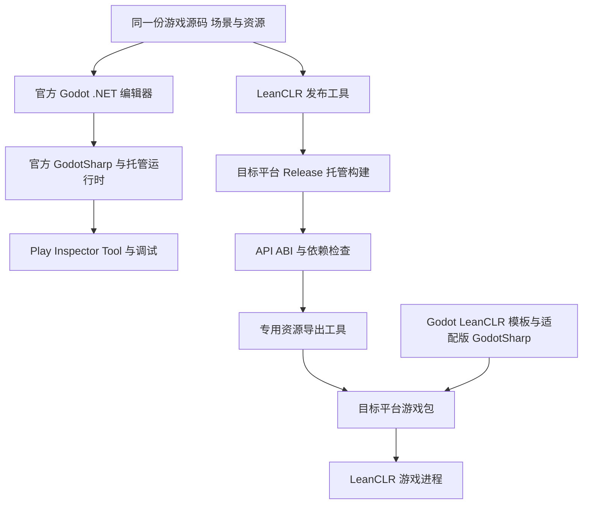

# Godot .NET 开发与 LeanCLR 发布技术方案

日期：2026 年 11 月 14 日。状态：M0–M5 已按本轮验收范围完成。本轮平台为 Win64、HTML5 和 Android x64；Android 使用 MuMu `localhost:7555`，其他平台与 ARM64 不在本轮退出门槛内。实测范围、性能预算和现有限制见 [M4 / M5 验收记录](m5-validation.md)；发布方式见 [SDK](publication-sdk.md)。

## 目标与架构决策

开发者继续使用官方 Godot .NET 编辑器、官方 GodotSharp 和标准 dotnet 工具链编写、运行及调试 C#。LeanCLR 仅用于发布后的游戏进程。业务代码、场景和资源保持同一份，发布时重新构建目标平台的 Release 程序集。

正式发布后端复用 Godot `modules/mono` 的 C# 脚本体系，并提供适配版 GodotSharp、LeanCLR 原生宿主和定制发布模板。现有 GDExtension 极简 demo 保留为底层回归样例；其“整数输入加批量快照”协议不扩展为正式 Godot C# API。

第一阶段承诺经过验收的源码兼容，不承诺原版 GodotSharp DLL 的二进制兼容。GodotSharp 的公开 API 应尽量复用官方定义；用户不需要在游戏逻辑中编写 `#if LEANCLR`。超出当前发布能力的 API 必须在发布检查中明确报错，不能静默改变行为。

| 决策 | 内容 |
| --- | --- |
| 开发编辑器 | 官方 Godot 4.7.2 .NET 版，保持原样 |
| 日常 Play 与调试 | 官方托管后端，LeanCLR 不进入编辑器或日常 Play 进程 |
| 游戏发布运行时 | LeanCLR `coreclr-minimal`，按已验证能力清单使用 |
| Godot API | 官方 API 表面，加发布专用的互操作实现 |
| 原生脚本支持 | 复用 `CSharpLanguage`、`CSharpScript` 和脚本实例体系 |
| 发布入口 | 独立 LeanCLR 发布命令，可由编辑器插件调用 |
| 资源导出 | 专用 headless 导出工具，复用官方导出器并替换 .NET 发布策略 |
| 运行时重载 | 首轮不实现进程内程序集卸载、VM 重启或热更新 |
| 首批发布目标 | Windows x64 和 WebAssembly32；随后扩展其他平台 |

开发编辑器与发布工具是两个产品组件。发布工具可以使用经过适配的 GodotTools，必要时包含定制的 headless editor 构建；它只存在于工具链私有目录，不替换用户安装的官方编辑器。目标游戏模板只运行 LeanCLR。

## 开发与发布的数据流



开发与发布输出必须隔离。发布使用的 GodotSharp 不写入开发项目的普通输出目录，也不覆盖官方 SDK 的缓存或安装文件。第一次发布验证以独立的 Release 工程目录进行，防止后端切换污染编辑器。

## 当前基线与能力差距

已固定的基线为 Godot 4.7.2、LeanCLR `7d9a431eb1313f9f61bc1b3b1bdfcdc5ea95ce48` 和 .NET 10.0.8 BCL。LeanCLR 已由 `extern/leanclr` submodule 管理；构建继续允许指定其他源码目录。Godot 源码也应使用独立、固定提交的依赖，业务适配补丁由本仓库保存，不能直接修改用户的 Godot 安装。

2026 年 11 月 13 日补充核对：最新本地 `coreclr-minimal`（`b5c25e33`）已支持 managed/unmanaged calli，并记录了 Windows x64、Wasm32 的静态签名桥与结构体 ABI 验收。后续适配应优先复用这套能力，而不是默认把全部 NativeFuncs 改成具名 P/Invoke。当前 demo 的 submodule 仍固定在上面的旧提交，本方案更新不自动升级该依赖。通用 reverse P/Invoke、UnmanagedCallersOnly 和嵌套函数指针 ABI 不在这轮 calli 验收范围，Godot 的具体签名仍需逐项验证。

现有 demo 已验证 Windows 和 Chromium WebGL2 下的程序集加载、固定缓冲区玩法、帧调用与终态退出。这些证据不包含 GodotSharp、脚本挂载、对象封送或同步回调。

| 现有能力 | 正式发布所需补充 |
| --- | --- |
| `Initialize / Tick / Shutdown` 公共宿主 | 可注册桥接、缓存入口及调用脚本桥的方法级宿主接口 |
| 单线程 owner 检查与生命周期防重入 | owner 线程上的合法同步回调嵌套与异常隔离 |
| 固定原生缓冲区交换 | 对象句柄、Variant、字符串、集合与结构体封送 |
| 自定义游戏入口 | 官方 C# 脚本类型注册、场景脚本映射、实例与通知 |
| GDExtension 导出 | 带 C# 脚本支持的定制 Godot 模板与独立发布流程 |
| 受控 minimal BCL | GodotSharp 实际依赖清单与对应运行时回归 |

现有 `engine_host` v1 保持兼容，继续服务极简样例。不要通过增加几个业务函数名，把它变成依赖 Godot 的运行时私有接口。

## 编辑器开发体验

开发项目继续引用官方 Godot.NET.Sdk 和官方 GodotSharp，使用正常的 C# 脚本挂载、Inspector、信号、源码生成与调试流程。首个兼容基线项目固定为经过官方编辑器验证的 `net10.0` 配置，其他目标框架后续独立验收。

停止后再次 Play、编译刷新和编辑器内的工具脚本重载由官方后端负责，不增加 LeanCLR 编辑器 VM。Godot 4.7.2 的标准 Play 使用游戏实例进程，嵌入游戏窗口也不能直接等同于进程内执行。[运行实现](https://raw.githubusercontent.com/godotengine/godot/4.7.2-stable/editor/run/editor_run.cpp)

可增加一个轻量编辑器插件，只提供以下功能：

- 配置 LeanCLR SDK 和发布目标，显示兼容性检查结果。
- 调用独立发布命令，展示构建进度和失败诊断。
- 启动 LeanCLR 发布验证包，和普通 Play 明确区分。

普通 Play 不被重定向为 LeanCLR。开发者可以继续按原有方式使用断点和官方 .NET 调试器；发布包问题依靠 LeanCLR 的诊断能力和独立验证流程定位。

## GodotSharp 源码兼容策略

### 两套实现与统一 API

开发侧使用官方程序集。发布侧从同一 Godot 源码版本构建适配版 `GodotSharp.dll`，尽量保留类型、成员、Attribute、程序集身份和源生成契约，仅替换底层运行时交互。

公开成员签名、基类、接口、默认值和泛型约束应使用自动化 API 对比。相同名称空间不等于兼容；编译通过也不等于资源和生命周期行为相同。

发布构建重新编译游戏源码及需要重编译的项目引用。第三方纯 IL 库可以进入兼容性扫描，但不能假设所有预编译 Godot 插件都能直接复用。程序集名称、版本、公钥标识与类型转发必须统一检查，同一发布包禁止混装官方与适配版 GodotSharp。

### 官方组件复用边界

| 组件 | 处理方式 |
| --- | --- |
| 数学类型、枚举、Attribute、公开 API 声明 | 优先复用官方源码，保留语义与签名 |
| ClassDB C# 绑定生成 | 在官方生成器上增加 LeanCLR 发布输出模式 |
| NativeFuncs | 优先保留官方函数表与 calli 路径，生成 LeanCLR 所需的签名桥；缺口单独适配 |
| ManagedCallbacks | 由原生侧生成 trampoline，不向 VM 索取任意原生函数地址 |
| ScriptManagerBridge 与 CSharpInstanceBridge | 复用脚本和实例逻辑，移除发布不需要的 ALC 重载依赖 |
| GodotPlugins | 提供单上下文发布 bootstrap，从清单加载程序集 |
| Godot.NET.Sdk 和分析器 | 日常开发保持官方；发布通过独立 MSBuild targets 选择适配程序集 |
| GodotTools | 日常版本不变；发布工具中的导出策略单独适配 |

官方 NativeFuncs 使用原生函数表，ManagedCallbacks 使用多种 unmanaged 回调签名，部分回调还接受另一层函数指针。因此只改一个初始化函数不足以完成替换。[NativeFuncs](https://raw.githubusercontent.com/godotengine/godot/4.7.2-stable/modules/mono/glue/GodotSharp/GodotSharp/Core/NativeInterop/NativeFuncs.cs)、[ManagedCallbacks](https://raw.githubusercontent.com/godotengine/godot/4.7.2-stable/modules/mono/glue/GodotSharp/GodotSharp/Core/Bridge/ManagedCallbacks.cs)

### 托管调用原生

以官方互操作函数签名和 GodotSharp IL 为输入，收集 calli 签名，使用 LeanAOT 的 `--calli-bridges-only` 模式生成静态 ABI 桥并随模板注册。对支持的签名保留官方 NativeFuncs 和 `godotsharp_*` 函数表，减少托管实现的改动。没有通过验收的签名再生成定向 shim、托管声明或原生 invoker；不要求用户通过通用 `object[]`、字符串反射或批量快照访问 Node API。

首轮复用已有的签名驱动静态桥，不引入通用 libffi。应检查 Godot 的 bool/char 实际底层类型、结构体布局、返回函数指针的接口、嵌套回调参数以及 Callable trampoline；已有 calli 支持不能直接推导出所有 Godot 互操作签名都可原样运行。反向回调仍按下面的原生 trampoline 方案验收。

生成器必须处理 bool 与整数宽度、指针、ref/out、结构体参数与返回、浮点精度、字符串编码和缓冲区初始化责任。GodotSharp 中的 native interop 结构属于 Godot ABI，应逐目标验证；运行时私有的 CoreLib 或 GC 布局不能泄漏给宿主。

官方原生 glue 可作为这些包装的语义基线。[runtime_interop.cpp](https://raw.githubusercontent.com/godotengine/godot/4.7.2-stable/modules/mono/glue/runtime_interop.cpp)

### 原生调用托管

按 ManagedCallbacks 的签名生成 C++ trampoline。各 trampoline 通过缓存的方法入口进入适配版 GodotSharp，检查并转换返回状态。托管桥接方法仍可由解释器执行，不要求 JIT 或每个游戏方法都生成原生代码。

Native callback table 由 C++ 填充；发布版托管代码不通过 `&ManagedMethod` 创建任意 UCO 函数指针。入口 token、参数描述与异常规则由生成清单校验。

桥接入口在启动时解析并缓存，帧循环和方法调用不重复扫描程序集。方法缓存持有泛型上下文与签名信息；句柄不能以宿主可见的私有 `RtMethodInfo` 布局表示。

### 同步回调与重入

必须支持 Godot 的正常同步调用链：

```text
C# 调用 EmitSignal 或原生对象方法
    → Godot 原生代码
    → Godot 同步调用 C# 委托或脚本
    → 返回原生调用
    → 返回最外层 C#
```

统一把这些回调延迟到下一帧会改变 API 语义，不能用于兼容模式。需要在 owner 线程上支持受控嵌套 VM 调用，维护调用帧、GC 根和每层异常状态；生命周期 start/stop/tick 的非法递归依然拒绝。跨线程事件不因此获得进入 VM 的权限。

M0 即建立最小嵌套调用契约，M2 验证真实同步信号。如果当前 runtime 无法可靠保存外层异常和执行状态，应先在核心修复，再继续绑定扩展。

## LeanCLR 公共接口建设

新能力进入 LeanCLR 主仓库，保持引擎无关，再更新本仓库 submodule。宿主不包含 `vm/`、`interp/` 或 CoreLib 私有布局头文件。

| 公共能力 | 必须明确的契约 |
| --- | --- |
| 方法解析与缓存 | 精确签名、泛型实例、静态与实例方法、句柄有效期 |
| 调用与返回 | 参数数量、类型、缓冲区大小、值类型与引用返回、异常状态 |
| 原生 invoker 注册 | 稳定 C ABI、错误返回、上下文与注册名所有权 |
| GC handles | 强引用、弱引用、释放、无效句柄检测与 owner 线程规则 |
| 嵌套调用 | 允许范围、栈与根恢复、异常隔离、最大深度 |
| 诊断 | 有界错误缓冲区、托管异常与堆栈导出、无递归错误格式化 |

必须先审计已有 C invoker 接口：当前 `LeanclrMethodInvoker` 声明为五参数、void 返回，而内部 `RtInvokeMethodPointer` 为四参数、`RtResultVoid` 返回；注册实现使用函数指针转换。正式双向调用前应增加真正的 C ABI 适配层与正负用例，不能假定这个转换可跨平台安全调用。[公共声明](../extern/leanclr/src/runtime/public/leanclr.h)、[注册实现](../extern/leanclr/src/runtime/public_impl/leanclr.cpp)、[内部签名](../extern/leanclr/src/runtime/metadata/rt_metadata.h)

同时固定调用成功时异常输出清零、失败时异常根的释放与嵌套调用恢复规则。现有 demo 未使用原生 invoker 注册，不能用其通过结果代替该接口的验收。

接口可以作为现有公共 API 的版本化扩展；具体名称在 M0 的头文件设计中确定。原生版本结构使用 size/version，托管与原生桥接通过完整签名摘要匹配，不能仅比较回调槽数。

## Godot 发布模板

### 原生后端边界

在 Godot 源码的 `modules/mono` 中增加发布 runtime backend，替换 `GDMono` 初始化、项目加载、回调表创建和停止路径。尽量保留已有类名和脚本资源类型，减少场景格式变化。

下列构建选项是拟议接口，不是当前已实现的 Godot 参数：

```text
module_mono_enabled=yes
dotnet_runtime_backend=leanclr
target=template_release 或 template_debug
```

LeanCLR 后端仅对游戏模板启用。日常官方编辑器不编译或加载该后端；发布工具若使用 CoreCLR 执行 GodotTools，也与目标游戏运行时分离。

`CSharpLanguage` 启动只创建一个进程级 runtime owner，随后加载 bootstrap、GodotSharp 和游戏程序集，注册脚本类型，再允许创建场景中的 C# 实例。帧回调沿用 Godot 现有脚本调度，不把所有脚本压入 demo 的一个 Tick 函数。

Godot 官方脚本系统已经包含 C# 类型、脚本扩展名、实例绑定和退出清理逻辑，适合在其边界内替换运行时。[csharp_script.cpp](https://raw.githubusercontent.com/godotengine/godot/4.7.2-stable/modules/mono/csharp_script.cpp)

### 对象与释放

保留 Godot 的对象身份和引用计数语义。原生对象与托管包装之间建立可失效的关联，GC handle 使用不透明 token；不能把未经 rooting 的托管地址长期存入原生对象。

Node 的场景树所有权与托管包装的 Dispose 分开处理；RefCounted 与 Resource 的强弱引用转换需要专门回归。对象销毁必须清除关联，取消信号／Callable 连接，拒绝迟到的回调，并防止跨 GC 与引用计数的环残留。

退出顺序为停止新事件与帧源、清理托管订阅和包装、解除原生绑定、停止 runtime，最后释放加载上下文。编辑器强杀游戏进程不保证逐对象清理执行，因此这些清理用于正常退出与资源生命周期，不能承担唯一的持久化责任。

### 程序集和脚本资源

发布 bootstrap 使用单程序集上下文，不依赖 collectible AssemblyLoadContext。适配版 GodotSharp 中与 ALC 有关的静态初始化、字典及卸载事件也需条件编译或重写，不能只替换 GodotPlugins 加载入口。[GodotPlugins](https://raw.githubusercontent.com/godotengine/godot/4.7.2-stable/modules/mono/glue/GodotSharp/GodotPlugins/Main.cs)

发布清单显式映射程序集身份、文件、哈希与加载顺序；脚本清单保留 `res://*.cs`、资源 UID 与托管类型的关联。场景引用可以继续指向原脚本资源，不要求发布包包含完整 C# 源码。需要保留资源占位、remap 和类型注册信息，不能简单排除全部 `.cs` 文件后期待脚本自动存在。

第一版关闭额外 IL 裁剪，以完整脚本清单跑通。随后只在有根保留文件和反射回归的条件下启用裁剪。

## 独立发布管线

### 发布命令与目录隔离

拟议发布命令如下，尚未实现：

```text
leanclr-godot publish --project <project.godot> --preset <preset> --target <target>
```

可先实现为跨平台 Python CLI，后续再提供打包工具和编辑器入口。MSBuild、Roslyn 与生成器仍由标准 dotnet 运行。

每次发布在独立 staging 目录执行；不修改开发目录中的 csproj、solution、GodotSharp、export preset、`.godot/mono` 或 NuGet 缓存。MSBuild 的中间与输出路径按 runtime、目标平台和构建 ID 隔离，防止两套 GodotSharp 的引用缓存串用。

### 发布阶段

1. 读取项目、平台预设和依赖锁，验证 Godot、SDK、绑定 ABI、runtime 与 BCL 组合。
2. 保存项目快照并构建发布专用 GodotSharp，使用独立 targets 替换引用，不修改业务源码。
3. 构建目标平台的游戏 IL 与项目依赖，保留官方平台条件编译语义；避免触发官方运行时的自包含／NativeAOT 发布。
4. 生成程序集、脚本、反射根和原生依赖清单，扫描兼容性。
5. 通过专用导出工具执行 Godot 资源导入、场景处理和 PCK 导出。
6. 将托管闭包、匹配目标的 BCL、原生依赖与 LeanCLR 模板组成发布包。
7. 执行包结构检查和目标运行测试，最后原子发布产物与报告。

AOT 不作为首轮前提。后续 LeanAOT 只能处理同一 runtime/ABI 构建支持的程序集和泛型闭包，并保留明确的解释执行回退清单。

### 官方导出器的限制与处理

Godot 4.7.2 的官方 C# ExportPlugin 会处理脚本资源和 .NET 发布输出，并在其发布路径中限制目标平台，当前平台列表不包含 Web。因此不能承诺在官方 .NET 编辑器中只选择一个自定义模板即可完成全部 LeanCLR 导出；简单删除 solution 文件也会与脚本资源校验冲突。[官方 ExportPlugin](https://raw.githubusercontent.com/godotengine/godot/4.7.2-stable/modules/mono/editor/GodotTools/GodotTools/Export/ExportPlugin.cs)

采用工具链私有的 headless 导出环境：复用同版本 Godot 导入器、资源导出器和官方 C# 脚本处理，替换其 .NET 发布策略为 LeanCLR manifest 驱动的打包。工具端可以继续用标准 dotnet 加载 GodotTools，目标游戏不包含 CoreCLR、hostfxr 或官方 Mono/Wasm 运行时。

M0 首先验证是否只需在工具私有目录部署适配版 GodotTools 即可完成 Windows 与 Web 导出。如果还有原生平台校验阻止导出，则构建专用 headless exporter 并保存最小原生补丁。两种实现都不改变用户的开发编辑器；发布 SDK 的体积和维护成本要包含这一工具。

只有确认某平台可以通过官方可扩展接口完整接管导出后，才减少专用工具依赖。不能以“额外注册了 EditorExportPlugin”作为已经绕过官方 C# 发布路径的证据。

### 清单和产物

发布清单至少包含：Godot 精确提交、runtime 提交、SDK 版本、公开 API 摘要、互操作签名摘要、目标 ABI、指针宽度、浮点精度、BCL 哈希、程序集身份与哈希、脚本路径映射、原生依赖和解释／AOT 模式。

运行时在创建脚本实例前检查不兼容的模板、程序集、绑定或 CoreLib，禁止半初始化后继续启动。清单路径必须受包内命名规则约束，未知程序集不从系统目录或工作目录隐式加载。

## 兼容性与发布诊断

兼容性清单分为 validated、unsupported、pending，并区分 Godot API、BCL API、原生调用和平台能力。扫描覆盖完整托管闭包；泛型、反射和动态构造需要脚本清单、保留规则与运行测试补充，静态扫描不能单独证明全部行为。

| 情况 | 默认处理 |
| --- | --- |
| 已验证 API 和平台组合 | 继续发布 |
| 明确不支持的线程、动态代码或本地库依赖 | 阻止发布，报告程序集、成员和可定位的调用位置 |
| 未验证的 API 或签名 | 标记 pending，正式发布门槛不自动放行 |
| 反射字符串等无法完整静态判定的调用 | 要求显式声明与对应集成用例 |
| 平台资源、网络、文件能力差异 | 进入平台能力检查，不以同名方法存在作为支持证据 |

不能把 ThreadPool 工作改成下一帧主线程任务后仍标注兼容，也不能为让扫描通过而放行整个 BCL 程序集。发布前允许有明确标记的实验检查模式，但它不能产生“兼容性已验收”的正式包。

## 平台发布

先稳定 Windows x64 和 Web32 的真实 C# 脚本发布，再扩 Linux/macOS、Android、iOS。各目标共享 API 与桥接生成器，独立验证模板、BCL 和原生依赖。

| 目标 | 主要交付与验收 |
| --- | --- |
| Windows x64 | 自定义 EXE 模板、PCK、托管闭包；干净系统运行与原生 ABI |
| WebAssembly32 | 内建 LeanCLR 的定制 Web 模板、PCK、32 位 BCL；真浏览器、内存增长和缓存 |
| Linux x64／ARM64 | 编译器、SysV/ARM ABI、库依赖与资源路径 |
| macOS x64／ARM64 | 架构切片、链接、签名和资源目录 |
| Android x64（本轮）／ARM64（后续） | 本轮以 MuMu APK 验证资源加载、后台恢复与进程重建；ARM64、AAB 和商店签名单独验收 |
| iOS ARM64 | 模板链接／嵌入方式、签名、设备执行与系统生命周期 |

正式 Web 模板将脚本系统和 LeanCLR 一同编译进 Godot，不再依赖当前 demo 的 GDExtension 侧模块作为唯一运行时入口。需要统一 Emscripten、内存增长、异常模型和线程配置；不能把不同工具链的主模块直接拼装。

CoreLib 不仅要匹配位宽，还要处于已验证的版本和平台能力范围。当前 x86 CoreLib 用于 Wasm 的做法只代表已有 minimal 范围，不能推导出全部桌面 OS API 在浏览器可用。

后台暂停、恢复和场景切换不调用终态 runtime stop；进程结束才停止 VM。仅把新平台编译成功不计为该平台支持已完成。

## 性能与内存设计

启动阶段解析脚本与方法并预热必要入口；普通 `_Process`、属性访问和信号派发使用缓存入口和生成包装。不要逐帧反射、组装 `object[]` 或按字符串扫描所有方法。

原生对象关联查询采用可失效句柄与常数时间索引；方法缓存按绑定 ID 查找。同步回调栈、临时封送和错误输出设定明确上限。热路径尽量使用栈存储和可复用缓冲区；复杂 Variant 操作的分配单独计量。

分别统计托管堆、元数据、解释器准备结果、原生对象、包装与 GC handles、事件连接、程序集与封送缓冲区。准确式全量 GC 的暂停用真实对象图测量，显式释放 Godot 资源，避免依赖 finalizer 的时机和线程。

以同一游戏场景比较官方发布后端和 LeanCLR 后端，采集启动、帧时间分位数、最长 GC 暂停、每帧分配、边界调用数量与峰值内存。预算在 M1 原型基线后确定，不使用极简 demo 的成功作为完整绑定的性能结论。

## 实施阶段与退出条件

| 阶段 | 交付物 | 必须通过的门槛 |
| --- | --- | --- |
| M0 接口与导出验证 | Godot 源码锁定、公共 ABI 修复方案、最小双向调用、headless 导出原型 | C ABI 在 Windows/Wasm 正负用例通过；同步嵌套可恢复；明确 Windows/Web 的官方导出阻断点与接管方式 |
| M1 Windows 脚本垂直样例 | 适配 GodotSharp、发布 backend、定制 Windows 模板 | 同一源码在官方编辑器运行；发布后真实挂载 C# Node2D，属性、帧回调、输入与位置更新一致 |
| M2 对象与脚本语义 | 对象关联、资源、Variant、信号、集合与泛型 | 同步信号、委托、实例化、继承、导出属性、场景保存加载、删除后访问、GC 与释放通过 |
| M3 Web 脚本发布 | 内建 LeanCLR 的 Web 模板与单一发布命令 | 同一工程发布到真实浏览器；脚本资源路径、输入、信号、GC、内存增长和刷新缓存通过 |
| M4 平台与 SDK 产品化 | CI、模板分发、发布报告、编辑器发布入口、桌面和移动包 | 各平台独立包和设备验收；开发工程未被发布改写；版本不匹配明确拒绝 |
| M5 优化与 API 扩展 | 热点 AOT、裁剪、更多已验证 API | 差异测试与性能预算通过，明确解释回退和元数据保留范围 |

M0 的公共 API 正确性和导出链路是两个前置条件，不能等到生成全套绑定后才检查。M1 至少需要一个能从场景实例化的脚本，不能以运行 bootstrap 代替。

首个垂直样例必须包含 `partial class Player : Node2D`、`[Export]` 属性、`_Ready`、`_Process`、Input 和 Position；M2 再加入自定义 Signal、同步回调、Resource 与 `PackedScene.Instantiate`。测试使用固定输入、随机种子和可比较的状态轨迹，在官方运行时与 LeanCLR 上执行同一业务代码。

## 仓库职责

| 位置 | 职责 |
| --- | --- |
| LeanCLR 主仓库 | 公共调用 ABI、GC handles、嵌套调用、BCL、GC/EH 与 runtime 回归 |
| `leanclr-godot/extern/leanclr` | 固定、经过验证的官方 submodule，保留外部源码覆盖能力 |
| 拟新增 Godot 源码依赖 | 固定 Godot 提交，不替换现有开发编辑器 |
| `godot_patches/` | 发布 runtime backend、平台构建和导出策略的最小补丁 |
| `managed/` 与生成器目录 | GodotSharp 发布适配、bootstrap、SDK targets 与双向桥生成 |
| 发布工具目录 | staging、扫描、导出、打包、报告和原子发布 |
| 样例与测试目录 | 官方 .NET 开发样例、双后端差异测试、平台与生命周期测试 |

不把 runtime 公共接口修复长期留在 submodule 脏工作树，也不复制 LeanCLR 核心进入 Godot。Godot 补丁按原生后端、构建、托管互操作、导出策略拆分；对同一 Godot 基线自动验证补丁应用与 API 摘要。

## 首个实施任务

先完成 M0 与 M1 所需的最小闭环：准备官方 Godot 4.7.2 .NET 开发样例与对应源码，审计并修复 LeanCLR 公共 invoker ABI，验证一组标量／结构体／异常／嵌套回调，跑通专用导出工具，再制作 Windows LeanCLR 模板加载一个真正的 C# Node2D 脚本。

M0–M5 已按本轮三个平台和已执行的 API 配置完成。官方开发编辑器与 LeanCLR submodule 保持原样；专用模板、发布版 GodotSharp、静态脚本工厂、桥接目录、混合 AOT、完整 IL／元数据保留及兼容性拒绝流程已有实现。Android 三个必要修复保存在构建副本及补丁中。后续新增平台、API、项目布局或裁剪策略必须扩展验证配置，不能由当前样例的成功直接推导。
