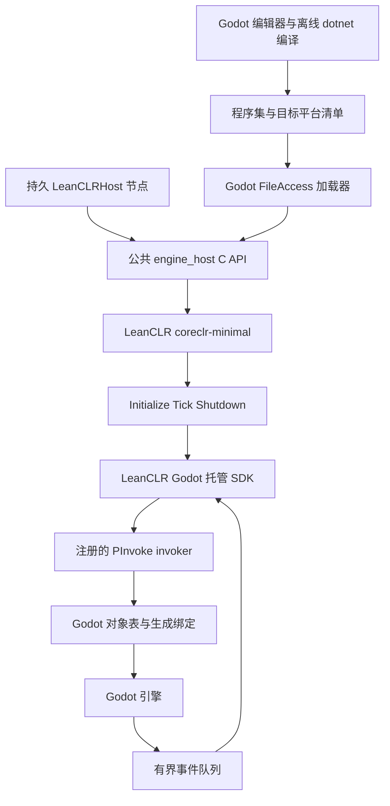

# Godot 集成 LeanCLR 技术调研报告

日期：2026 年 11 月 12 日

## 技术结论

建议以 `leanclr-godot` 为独立宿主仓库，固定 LeanCLR `coreclr-minimal` 的提交版本，先采用 **GDExtension、进程级单实例、主线程执行、显式生成的互操作包装**，完成可发布的 C# 游戏逻辑宿主。随后再建设脚本资源与编辑器集成。

必须区分两个交付目标：

| 目标 | 用户得到的能力 | 主要工作 |
| --- | --- | --- |
| C# 逻辑宿主 | Godot 启动 C#，C# 操作受支持的节点、接收事件，随游戏导出 | 生命周期、程序集加载、原生调用、对象与事件、打包 |
| Godot C# 脚本替代后端 | 现有 `partial class Player : Node`、挂载脚本、Inspector、`[Export]`、`[Signal]` 等体验 | 上述全部能力，加上 GodotSharp 兼容、脚本实例、绑定生成器、工具链与编辑器适配 |

第一个目标可以从当前公共接口起步；第二个目标有明确的运行时和引擎适配缺口，不能通过替换 `coreclr.dll` 或修改一次加载入口完成。

如果产品的首要要求是现有 Godot C# 项目低成本迁移，应把“适配 `modules/mono` 并保留 GodotSharp API”设为正式路线，先做兼容性原型。GDExtension 的最小宿主可以验证运行时与互操作，但它的自定义托管 API 不会自动变成 GodotSharp 兼容实现。

## 调研基线

### 本地仓库

| 项目 | 本次基线 | 状态 |
| --- | --- | --- |
| Godot 宿主 | `D:\workspace\wasmclr\hosts\godot\leanclr-godot` | 当前仅有 README 和 LICENSE，尚无集成实现 |
| LeanCLR | `coreclr-minimal`，`7d9a431eb1313f9f61bc1b3b1bdfcdc5ea95ce48` | 位于现有工作树 `D:\workspace\wasmclr\leanclr-coreclr-minimal` |
| BCL | `CORECLR_NET10` | 精简 .NET 10 BCL 适配，不等于完整 Microsoft.NETCore.App |
| Godot 源码分析 | 官方 `4.5-stable` 标签 | 作为可复核源码基线，不表示它是当前最新版或最终产品版本 |

实施时还需锁定 Godot 精确提交、对应 godot-cpp、API JSON、CoreLib 文件与哈希、目标架构、浮点精度和工具链。不能仅依赖可移动的分支名。

本报告属于源码与已有证据调研。本次未编译 Godot、未运行真实引擎集成，也未重新执行 LeanCLR 历史测试；下面的测试数字均是当前分支文档记录的既有结果。

### 当前 LeanCLR 可复用能力

公共入口是 [engine_host.h](D:/workspace/wasmclr/leanclr-coreclr-minimal/src/runtime/public/engine_host.h)，实现位于 [engine_host.cpp](D:/workspace/wasmclr/leanclr-coreclr-minimal/src/runtime/public_impl/engine_host.cpp)。它提供：

```text
leanclr_engine_start(config, session, error)
leanclr_engine_tick(session, delta_seconds, error)
leanclr_engine_stop(session, error)
leanclr_engine_state(session)
```

托管入口固定为：

```csharp
public static void Initialize();
public static void Tick(float deltaSeconds);
public static void Shutdown();
```

初始化解析并缓存入口方法，Tick 使用缓存方法与栈参数；桥接层本身避免逐帧扫描和分配，但托管逻辑、首次方法准备和 GC 仍有成本。

它已经处理配置版本、错误状态、程序集字节上限、文件缓冲区复制与释放、线程归属、重入拒绝和托管异常边界。默认单程序集字节上限为 64 MiB，net10 类型句柄外观数量默认上限为 16,384；二者均不构成完整运行时内存配额。

SDK 无关的 [engine_adapters.h](D:/workspace/wasmclr/leanclr-coreclr-minimal/src/host-bridge/engine_adapters.h) 已提供 Godot `enter_tree / process / exit_tree` 对应钩子，但它既未注册 Godot 类，也未实现 Variant、对象、资源和导出适配。

分支记录了 Windows x64 Debug、ASan、共享库 Release 和 Node Wasm32 各 14/14 个引擎宿主契约用例通过；这些结果不能替代真实 Godot 启动和浏览器验收。历史 .NET 10 兼容矩阵为 434/459 组，仍存在 I/O、线程和异步等缺口。详见 [宿主契约](D:/workspace/wasmclr/leanclr-coreclr-minimal/docs/coreclr-net10-engine-host.md)、[开发状态](D:/workspace/wasmclr/leanclr-coreclr-minimal/docs/coreclr-net10-development-status.md) 和 [API 覆盖](D:/workspace/wasmclr/leanclr-coreclr-minimal/docs/coreclr-net10-api-coverage.md)。

## Godot 现有 C# 集成的组成

Godot 4 的目录虽然仍叫 `modules/mono`，其中桌面启动逻辑已经包含 hostfxr 和 CoreCLR 宿主入口。因此不能按旧版 Godot 的 Mono embedding 模型判断接入成本。[Godot 4.5 gd_mono.cpp](https://raw.githubusercontent.com/godotengine/godot/4.5-stable/modules/mono/mono_gd/gd_mono.cpp)

可将现有链路理解为：

```text
Godot C++ 场景与脚本系统
    ↓
modules/mono 中的脚本实例与 runtime interop
    ↕ 原生函数表和托管回调
GodotSharp 中的 GodotObject、Variant、脚本桥接
    ↕
游戏程序集与源生成代码

启动和加载：GDMono → hostfxr/CoreCLR → GodotPlugins
编译和导出：Godot.NET.Sdk、生成器、编辑器与平台构建工具
```

启动只占其中一部分。原生调用由 `NativeFuncs` 接收函数表；脚本桥接负责创建包装对象、分配 GCHandle、注册脚本类型和转发信号。GodotPlugins 使用 AssemblyLoadContext 管理项目程序集，并设置原生库解析器。[NativeFuncs](https://raw.githubusercontent.com/godotengine/godot/4.5-stable/modules/mono/glue/GodotSharp/GodotSharp/Core/NativeInterop/NativeFuncs.cs)、[ScriptManagerBridge](https://raw.githubusercontent.com/godotengine/godot/4.5-stable/modules/mono/glue/GodotSharp/GodotSharp/Core/Bridge/ScriptManagerBridge.cs)、[GodotPlugins](https://raw.githubusercontent.com/godotengine/godot/4.5-stable/modules/mono/glue/GodotSharp/GodotPlugins/Main.cs)

由此推导：复用官方 C# 生态时，需要适配启动、双向调用、对象和脚本、BCL 依赖、编译导出这五个方面。只解决启动，只能证明程序集被加载。

## 三种集成路线

| 路线 | 优点 | 成本和限制 | 建议 |
| --- | --- | --- | --- |
| A GDExtension 加受控托管 SDK | 独立分发，适配边界清晰，可直接复用最小生命周期 | 初期不兼容 GodotSharp 脚本；需要自己的绑定与导出插件 | 当前第一阶段首选 |
| B 改造 `modules/mono`，增加 LeanCLR 后端 | 可复用已有场景、脚本、Inspector 和 C# API 体系 | 要适配双向 ABI、GodotSharp、构建导出；维护引擎补丁 | 原项目兼容优先时的正式路线 |
| C 用 GDExtension 实现完整脚本语言 | 保持插件分发，同时提供脚本挂载能力 | 自建语言、资源、实例、编辑器和托管 SDK，工程量大 | A 稳定后的可选演进 |

路线 A 与 B 可以共享加载、句柄、封送与生成器基础设施，但各自的托管 API 和脚本模型需要明确边界。不要先发布大量自定义 API，再默认承诺无成本迁移到 GodotSharp。

路线 C 有公开机制支持：Godot 提供 ScriptLanguageExtension、ScriptExtension 与脚本实例 C 接口，4.5 的 GDExtension 接口还包含 `object_set_script_instance`。这说明完整语言集成可以通过扩展开展，并不表示创建一个 Node 扩展就已经具备脚本语言能力。[ScriptLanguageExtension](https://docs.godotengine.org/en/4.5/classes/class_scriptlanguageextension.html)、[ScriptExtension](https://docs.godotengine.org/en/4.5/classes/class_scriptextension.html)、[GDExtension 接口](https://raw.githubusercontent.com/godotengine/godot/4.5-stable/core/extension/gdextension_interface.h)

## 第一阶段架构



### 运行时所有者与进程模型

注册一个原生 `LeanCLRHost : Node`，由 Autoload 或应用根节点持久持有。扩展初始化时注册类型；进入实际游戏运行后才启动 VM。切换场景不得销毁运行时所有者。

当前契约是“一进程一次实际初始化尝试”：进入启动阶段后，启动失败和 Shutdown 都是终态。Shutdown 表示停止调用，不表示卸载元数据、执行全部终结器或允许再次初始化。因此：

- 编辑器中仅加载扩展和展示配置，第一阶段不启动 VM，不执行 `[Tool]`。
- 每次运行使用新游戏进程；明确关闭或绕开可能让游戏进入编辑器同进程的运行方式。
- 修改 C# 后重新编译并重启游戏进程。场景重载不等于程序集重载。
- `.gdextension` 设置 `reloadable = false`；这只禁止扩展库开发重载，不会给 VM 增加卸载能力。

Godot 的 `.gdextension` 文件支持入口、兼容版本和按平台选择库，也提供 `reloadable` 配置。[官方配置说明](https://docs.godotengine.org/en/4.5/tutorials/scripting/gdextension/gdextension_file.html)

结束顺序应为：停止 tick 与外部事件源，拒绝新订阅和工作请求，执行托管 Shutdown，断开连接并释放残余宿主资源，最后释放加载器上下文。Shutdown 期间仍可能进行清理调用，不能提前销毁桥接对象。VM 已终止后不得由迟到的析构或信号再次进入托管代码。

### 程序集和资源加载

实现 `load_file / release_file` 回调，把程序集名映射到导出清单中的 `res://leanclr/managed/...` 路径，通过 Godot FileAccess 读取。运行时会复制成功返回的缓冲区，宿主应在对应 release 中释放原缓冲区，避免同时永久持有两份程序集。

路径通过受控清单解析，验证程序集名和扩展名，禁止任意路径拼接。区分缺失、读取失败、空文件、文件过大和 CoreLib 不匹配，给出具体诊断。首轮缺失 CoreLib 的失败也会消耗实际启动机会，应在启动前完成包内容预检。

导出插件必须显式加入 DLL 与所需数据。编辑器能看到文件，不代表它已经进入 PCK；不能依赖默认资源过滤恰好保留程序集。CoreLib 按目标宽度和已验证配置分包，记录版本及 SHA256。

对于第一阶段游戏 I/O，提供 Godot FileAccess、ResourceLoader、HTTPRequest 等能力的受控包装。`load_file` 只是程序集加载器，不会使 `System.IO.File` 自动获得 Godot `res://` 支持；选择 `LEANCLR_HOST=NATIVE` 也不会补齐 net10 BCL 的全部 OS P/Invoke。

### 帧循环和事件

`_process(double delta)` 在检查有限值和 float 转换范围后转给 `Tick(float)`。保持一次 VM 入口处理一批游戏逻辑，避免为每个对象都从 C++ 经反射进入 C#。

Godot 主线程可能在执行 C# 发起的原生调用时同步发出信号。若信号再次进入 VM，就与现有防重入契约冲突。因此第一阶段统一采用“原生事件排队，C# 在 Tick 内拉取并派发”的模型，不在原生信号回调中直接调用托管委托。

事件记录包含订阅 token、对象句柄、必要参数和序号；队列固定容量或有硬上限。定义每帧最大派发数、溢出诊断、取消订阅后的迟到事件处理，以及事件参数中 RefCounted 对象的持有规则。先取出本批事件再执行回调，避免回调无限生成新事件并在同帧自旋。

首个样例采用普通帧逻辑。需要 `_physics_process`、输入、通知等精确相位时，应增加有版本的公共 phase/event 契约，或明确设计阶段分发协议；不能把所有事件推迟到下次 `_process` 后仍声称与官方 Godot 脚本时序完全等价。要求同步返回值的虚方法也需要专门设计，不能由异步事件队列替代。

## 互操作设计

### 当前最重要的 ABI 缺口

LeanCLR 的 [Transformer::add_calli](D:/workspace/wasmclr/leanclr-coreclr-minimal/src/runtime/interp/transformer.cpp:1421) 对非默认调用约定返回 NotSupported；[AOT 契约](D:/workspace/wasmclr/leanclr-coreclr-minimal/docs/coreclr-net10-aot-contract.md) 也明确将 unmanaged/native calli 的 ABI lowering、GC 根描述与异常快照列为独立工作。

Godot 官方桥接包含 `delegate* unmanaged` 和 `[UnmanagedCallersOnly]`。因此不能把 Godot 的原生函数表直接交给解释执行的 GodotSharp，并假设它能按普通托管 calli 正确调用。反方向也不能把 LeanCLR 的托管方法地址直接当作 C ABI 回调指针。可用的 reverse PInvoke trampoline 和全部平台 ABI 仍需逐项验证。

这既是路线 B 的前置工作，也是路线 A 应采用显式 invoker 的理由。

### 第一阶段的调用桥

[public/leanclr.h](D:/workspace/wasmclr/leanclr-coreclr-minimal/src/runtime/public/leanclr.h) 已提供 `leanclr_register_pinvoke_func`、参数读写辅助函数和调用接口。建议为受控静态 PInvoke 方法生成固定签名的原生 invoker，由包装层转调 Godot C++ API。

具体规则：

- 按程序集、类型、方法和参数签名注册，生成代码和注册表必须来自同一次构建。注册名存储需要覆盖运行时使用期，不能借用临时字符串。
- 在 Initialize 可能调用绑定之前完成注册，并通过独立用例固定注册顺序；仅注册绑定不得另行初始化第二个 VM。
- 初始边界只传固定宽度标量、对象句柄、指针加长度和已约定的 POD。字符串和复杂数据先封送为显式缓冲区，避免直接暴露托管对象地址。
- 使用公共参数辅助函数读写栈槽，不在宿主复制 `RtStackObject`、BCL 对象布局或 GC 内部实现。
- 原生错误转换为状态码和有限错误信息，托管异常在 VM 边界处理，C++ 异常不得穿越 C ABI。

建议首批接口覆盖日志、查找 Node、读取和设置 Node2D 位置、读取输入、订阅与取消少量信号、加载受控资源。以一个真实小游戏的需求确定集合，避免第一版生成全部 ClassDB。

### 对象身份和所有权

采用“slot 加 generation”的宿主句柄，宿主表保存 Godot ObjectID 和必要的引用。每次解引用校验 generation 与引擎对象存活状态，不允许把裸 Node 指针长期保存在托管层。

| 对象种类 | 建议的所有权 |
| --- | --- |
| 场景树持有的 Node | 托管包装默认借用；Dispose 断开包装与订阅，销毁 Node 使用显式操作 |
| C# 请求创建但未挂树的 Node | 明确由宿主暂持有并负责失败回滚、挂树或销毁，避免失去 owner |
| RefCounted 和 Resource | 每个持有句柄对应明确的原生强引用，释放时只减一次 |
| 事件订阅 | 用 token 表示连接，取消、对象销毁和 Shutdown 都能幂等清理 |
| 托管回调目标 | 最小模型由托管 dispatcher 表持有；将来需要 native 持有托管对象时再补公共 rooted handle API |

当前 `engine_host` 没有通用对象与 GCHandle 接口，`leanclr.h` 也不能被视为已提供完整的外部 GC 根管理。最小模型把托管对象保存在托管表中，通过数字 ID 调度，避免宿主持有未注册为根的托管指针。需要更强能力时在 LeanCLR 公共 API 中补齐并测试，而非 include 私有 GC 头文件。

跨 GC 与引用计数的环必须显式打断。例如“原生信号连接持有订阅，订阅持有委托，委托持有 Resource 包装，包装持有原生引用”会使两边都无法自行释放。Dispose、对象销毁和 Shutdown 必须覆盖这些环。

### Variant 和值类型

先定义桥接 wire 格式，再在 C++ 内转换为 Godot 值。避免让自定义托管 SDK 直接依赖 Godot 私有 Variant 布局。

| 类型 | 初始处理方式 |
| --- | --- |
| bool、整数和枚举 | 明确 8/32/64 位宽度与符号；Godot int 与 C# int 的窄化显式检查 |
| 浮点和 Vector | 明确 float/double，校验引擎精度；首版锁定单精度构建 |
| String | 明确 UTF 编码、长度、NUL、借用范围和复制责任 |
| StringName、NodePath | 由原生句柄或显式构造销毁包装持有，缓存常用名称 |
| Array、Dictionary、PackedArray | 首版复制或受控句柄；批量接口优先，零拷贝需另定 pin 和借用契约 |
| Object、Callable、Signal | 分别通过对象句柄、订阅/回调 token 表示 |

Godot 官方互操作结构包含显式布局、union 和专门释放函数；C# 结构体可编译不代表它在其他精度、位宽和 ABI 下安全。路线 B 需对这些结构逐项做布局与所有权验证。[InteropStructs](https://raw.githubusercontent.com/godotengine/godot/4.5-stable/modules/mono/glue/GodotSharp/GodotSharp/Core/NativeInterop/InteropStructs.cs)

## 完整 Godot C# 兼容路线

若选择路线 B，建议在 Godot 源码的 `modules/mono` 内保留现有脚本体系，增加独立 runtime backend，让启动、项目加载、托管回调创建和停止经过后端接口。Godot 相关补丁保存在 `leanclr-godot`；LeanCLR 核心问题修复回到运行时仓库。

首先决定 GodotSharp 的两种适配策略：

| 策略 | 工作 | 影响 |
| --- | --- | --- |
| 直接运行官方 GodotSharp | 补齐 unmanaged calli、reverse PInvoke、相关 BCL 与 ABI | 更接近程序集兼容，但运行时工作量和平台验证范围最大 |
| 从官方源码生成 LeanCLR 变体 | 保留尽可能多的公开 API，把底层函数指针与回调生成改成受控桥接 | 更容易限制运行时范围，但只能按测试承诺源码兼容，不能默认二进制兼容 |

对 minimal 分支，优先验证第二种策略。重新编译游戏与适配版 GodotSharp；保留数学类型、名称和签名时，仍要验证生成代码、Attribute、反射、泛型、Callable、Dispose 与脚本路径映射。

需要逐项解决：

1. **加载与重载**：替换或绕开 GodotPlugins 的 ALC 路径。第一版禁用程序集卸载，项目变更后重启进程。不能用当前 Shutdown 假装 ALC unload。
2. **托管回调表**：为每类回调提供可检查的 trampoline 或统一调度入口，覆盖宽值返回、异常与 GC 根；不要强转方法地址。
3. **脚本实例**：绑定脚本类型、原生基类、构造函数、通知、方法调用、属性和对象生命周期，验证 Node、Resource 和 RefCounted。
4. **编译工具链**：审核 Godot.NET.Sdk、分析器与源生成器，明确目标框架。宿主采用 net10 BCL，并不会自动让其他 Godot 版本的 SDK 和项目产物兼容。[Godot.NET.Sdk 属性](https://raw.githubusercontent.com/godotengine/godot/4.5-stable/modules/mono/editor/Godot.NET.Sdk/Godot.NET.Sdk/Sdk/Sdk.props)
5. **BCL 依赖**：盘点 GodotSharp、游戏和第三方库使用的线程、同步、反射、NativeLibrary、Runtime.Loader、Unsafe、集合与异步 API，分为已验证、待支持、明确拒绝。
6. **工具执行环境**：Roslyn、MSBuild 和编辑器构建工具继续在开发机标准 dotnet 进程中运行；目标 minimal VM 只运行游戏闭包。若编辑器仍使用官方托管后端，必须另外验证工具进程、目标框架与生成产物的一致性。

路线 B 的最小判定样例应为：一个真正挂载的 C# Node 脚本，包含导出属性和信号，能保存场景、重启、实例化、运行并在原生对象删除后安全失效。它比单独运行 Initialize 更能判定该路线是否可交付。

如果选择路线 C，则实现 `LeanCLRScriptLanguage`、`LeanCLRScript`、脚本实例、资源 loader/saver、Inspector 元数据和导出插件。可先用自定义脚本资源后缀避免与官方 `.cs` 处理器争用，并通过离线生成清单映射 C# 文件、程序集和类型。此路线的兼容性同样按实际验证范围发布。

## 平台与构建发布

### 构建组成

LeanCLR 分支、BCL 和 Host Provider 是不同维度。当前 `coreclr-minimal` CMake preset 选择 `CORECLR_NET10 + NATIVE`；构建默认仍可能走 Mono，必须显式指定。建议使用顶层构建把固定版本 runtime 静态链接到宿主扩展，减少版本组合和加载错误；桌面开发可以单独验证 shared DLL 形式。

```text
LeanCLR 固定提交
  + CORECLR_NET10
  + 已验证的 NATIVE / PORTABLE / CUSTOM 服务配置
  + Godot 与 godot-cpp 固定版本
  + LeanCLR Godot 桥接与托管程序集
  + 目标位宽 CoreLib 与依赖清单
  = 每个平台独立的宿主发布包
```

CUSTOM 注入内存、时钟、I/O 等属于后续可选工作；当前 engine config 没有这些全部配置项，不能写出未实现的初始化调用。首版通过现有服务构建配置和 Godot 专用 SDK 包装满足需求。静态链接应检查 PIC、CRT、导出符号、可见性和第三方库冲突。

### 平台次序

| 平台 | 建议安排 | 关键验收 |
| --- | --- | --- |
| Windows x64 | 第一平台 | 编辑器外游戏进程、PCK、原生 DLL、错误恢复与退出 |
| Linux x64、macOS | 桌面扩展阶段 | 不同编译器、库加载、路径大小写、签名与平台服务 |
| Web Wasm32 | 桌面闭环后的重点 | 真浏览器、Wasm 链接与导出模板、32 位 CoreLib、PCK 和内存峰值 |
| Android ARM64 | 移动阶段 | ABI、AAR/原生库打包、资源路径、暂停恢复和低内存 |
| iOS ARM64 | 独立平台阶段 | 签名、允许的链接与代码发布形式、设备执行及生命周期 |

当前官方稳定 Web 导出文档仍标注 Godot 4 C# 项目不能直接 Web 导出；该限制针对官方链路，不能据此断言独立 LeanCLR 宿主不可行。文档也要求 GDExtension 项目启用 Extension Support。[Godot Web 导出](https://docs.godotengine.org/en/stable/tutorials/export/exporting_for_web.html)

Web 建议先验证 Godot 的扩展支持模板与同一 Emscripten ABI 的侧模块；若链接、工具链或体积约束不合适，再以同一宿主逻辑实现内建模块并静态链接到自定义模板。不要把独立 Emscripten 主模块或普通桌面动态库直接当作 Godot Web 扩展。

目标应让 Godot 与 LeanCLR 处于同一有效 Wasm 地址空间和匹配的表、内存契约中；放在两个独立 JS/Wasm 实例后无法直接共享裸指针。统一异常模型、线程选项、内存增长与最大内存，验证 TypedArray 视图在 memory growth 后的处理。

当前分支 Wasm 契约使用匹配位宽的 x86 .NET 10 CoreLib 包，而非开发机 x64 CoreLib。该选择只能沿用到已验证的 minimal 范围，不能据此承诺其他 OS API。Node 契约通过也不等于浏览器中的 Godot 渲染、音频、输入与后台切换通过。

### AOT 安排

第一阶段先以解释执行跑通完整链路，AOT 只用于后续测得的热点。LeanAOT 产物需要与 runtime 同构建的模块注册表，不能直接把 Microsoft NativeAOT 产物作为 LeanAOT 模块。

生成物、桥接函数、托管 DLL 与 CoreLib 都写入构建清单。对泛型、反射、脚本类型和事件回调保留元数据；裁剪不应先于脚本清单和根保留机制。首次方法准备放在加载阶段预热，避免把冷启动成本混入首个交互帧。

## 稳定性 性能与内存

### 稳定性约束

- 全部托管执行固定在启动线程。Godot 的渲染、音频、资源工作线程不得直接进入 VM；通过安全的原生队列归并。
- 不承诺 Thread、Task.Run、ThreadPool。Godot 驱动的主线程 await 可以另做调度器，但不自动获得完整 Task、Timer、取消和异步 I/O 语义。
- native 回调禁止重入 VM；需要同步返回的接口单独设计并验证。
- 入口异常采用有状态策略：初始化失败终止本次游戏启动；Tick 失败暂停或禁用调度并记录一次完整诊断；需要时保留可配置的继续策略。当前 API 本身允许 Tick 失败后继续，宿主必须自行决定。
- 释放路径覆盖初始化部分成功、重复 Dispose、对象先销毁、订阅期间退出、延迟事件和加载失败。最终状态查询不得触碰已释放的回调上下文。

### 热点设计

初始化时生成或缓存绑定、方法标识和 StringName；帧循环不做程序集扫描、字符串反射或通用 `object[]` 参数组装。常用属性走生成的类型化路径，低频工具调用再允许通用 Variant 路径。

对象句柄查询采用数组槽 O(1)，事件派发为本批事件数 O(n)，每帧对象更新为活跃对象数 O(m)。避免每次查句柄遍历全部对象、逐对象扫描订阅表，或为所有 API 使用逐帧字符串查找。高频位置与数组操作提供批量接口，跨 VM 边界次数通常比单次函数体优化更值得先测。

### 内存预算

分别统计 runtime 代码、CoreLib 与托管 DLL、元数据、解释器准备结果、托管堆、Godot 原生对象、句柄表、事件队列与临时封送缓冲区。加载峰值需计入宿主缓冲区与 runtime 复制短暂共存。

公共宿主契约不等于无泄漏卸载，进程级元数据也不会在每次 Shutdown 归零。第一阶段更应限制游戏进程生命周期，而非用每次切场景重启 VM 控制内存。

LeanCLR 的准确式 Mark-Sweep 全量 GC 可能影响帧尾延迟，需要用真实对象图和事件压力测量暂停。显式 Dispose 管理 Godot 资源，不能等待托管 finalizer 在合适线程、合适时机执行。

Mono minimal 的宣传体积不能直接用作 CoreCLR BCL 宿主包预算。应同时给出原生库、程序集、未压缩/传输包、冷启动峰值和稳定运行内存。

### 基准方法

使用同一场景、渲染设置、对象数和构建等级，比较 GDScript、官方 Godot C# 与 LeanCLR 路线；仅对语义与功能相当的场景比较。将空场景 Godot 成本单列。

至少测量冷启动、热帧 p50/p95/p99、最坏 GC 暂停、每帧分配、边界调用数量、批量吞吐、稳定堆大小、native 资源计数、Wasm 内存峰值和发布大小。阈值在首个原型取得基线后确定，不能用孤立方法的解释器/AOT 跑分替代整帧结论。

## 实施顺序与验收

下列阶段以退出条件划分，不预设未经原型校准的工期。

| 阶段 | 交付物 | 退出条件 |
| --- | --- | --- |
| P0 固定版本与真实启动 | GDExtension 工程、LeanCLRHost、程序集加载器、入口样例 | Windows 标准 Godot 版本加载扩展；游戏进程 Initialize/Tick/Shutdown；重复运行使用新进程；缺失与错误 CoreLib 可诊断 |
| P1 最小双向链路 | 日志、Node2D、输入、对象表、事件队列 | C# 驱动节点；真实信号在 Tick 派发；对象销毁后句柄拒绝；订阅与资源可清理 |
| P2 可发布桌面包 | 导出插件、依赖清单、平台资产 | 导出后在无 .NET runtime 的干净机器运行；DLL/PCK 完整；关闭退出稳定 |
| P3 Web 垂直样例 | Wasm 构建、模板、32 位 BCL 包、浏览器样例 | Chrome/Firefox 等目标浏览器真实运行；输入、PCK、后台恢复、memory growth 与内存峰值通过 |
| P4 脚本产品决策 | 路线 B 或 C 的真正脚本原型 | Node 脚本挂载、属性、信号、保存重开、实例化与释放；据兼容性和维护量确定产品路线 |
| P5 优化与平台扩展 | 热点 AOT、更多 API、移动包 | 基准改善可复现；新增平台各自完成 SDK 和设备验收 |

P4 可在 P1 后提前进行探索。如果低成本迁移现有 Godot C# 项目是硬要求，应先完成 P4 的路线 B 原型，再扩大 P2/P3 的自定义 SDK，避免形成两套长期绑定。

首批真实集成用例应覆盖：

1. 连续新进程运行、切换场景、退出窗口和显式 Shutdown。
2. 错误入口签名、初始化异常、Tick 异常、Shutdown 异常和重复关闭。
3. CoreLib 缺失、错误位宽、读取失败、大程序集拒绝及 load/release 数量平衡。
4. native 非 owner 线程调用、原生同步信号引发潜在重入、队列溢出。
5. Node 删除后访问、RefCounted 存活与释放、过期 generation、取消后迟到事件。
6. GC 发生于原生调用前后及事件派发期间，验证托管根和原生引用。
7. 导出 PCK、干净机器启动和真浏览器运行。

宿主用例与运行时契约分开运行；运行时内部修复仍回归 engine-contracts、相关 .NET 10 GC/EH/API 与 AOT 用例。API 扫描器可先生成依赖盘点，unknown 保持 pending，新增验证后再扩支持清单；不能为了通过扫描而按整个程序集放行。

## 仓库组织建议

以下是拟议目录，当前尚未创建实现：

```text
leanclr-godot/
  docs/                    技术决策、兼容清单、平台验收
  native/                  扩展入口、Host 节点、加载器、对象表、事件队列
  managed/                 受控托管 SDK、生命周期入口、调度器
  generator/               类型化绑定与注册表生成
  addons/leanclr/          编辑器配置与导出插件
  samples/                 桌面与 Web 垂直样例
  tests/                   Godot headless 与真实导出测试
  scripts/                 构建、打包和发布清单工具
  third_party/             固定提交的依赖或依赖锁文件
  godot_patches/           仅路线 B 或内建模块需要的引擎补丁
```

LeanCLR 核心、BCL、GC 和解释器不复制到宿主目录维护。宿主只使用公共契约；确有缺口时在 runtime 增加引擎无关接口与回归测试，再由 Godot 适配。给 Godot、godot-cpp、LeanCLR、CoreLib 和生成绑定统一版本清单，避免原生二进制与托管程序集错配。

## 建议的首个实施任务

先实现一个 Windows x64 的 GDExtension 垂直样例：以普通 Godot 项目加载 LeanCLRHost，读取 PCK 内 net10 程序集，进入固定入口，通过注册 invoker 输出日志并移动 Node2D，再用一个真实 Godot 信号驱动 C# 状态变化，最后导出并在无 .NET runtime 的机器运行。

这项任务同时检验启动、BCL、原生 ABI、对象生命周期、事件调度和打包。完成后即可根据真实数据判断下一阶段是扩大受控 SDK、推进 Web，还是优先适配官方 C# 脚本后端。
